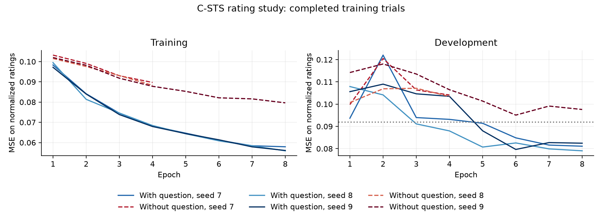
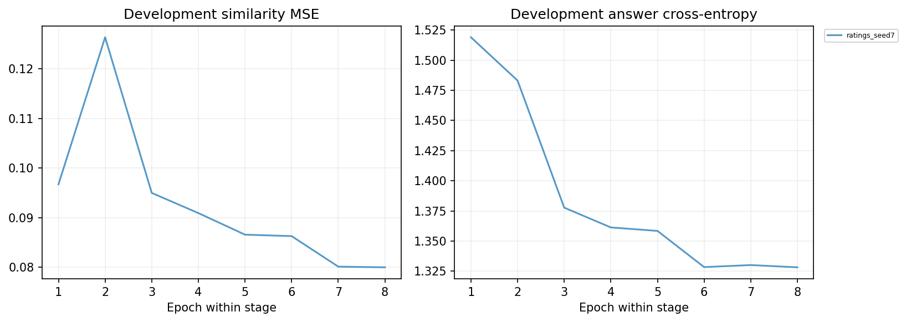

# C-STS results

The rating study is complete. All selected checkpoints and evaluation artifacts are stored in VIPER. These scores use 2,620 reserved comparisons from 1,241 caption groups.

| Model | MSE | Spearman | Question ordering |
| --- | ---: | ---: | ---: |
| With question | 0.1443 | 0.432 | 76.1% |
| Without question | 0.1723 | 0.125 | 50.0% |
| Constant training mean | 0.1681 | Undefined | 50.0% |

Model scores average seeds 7, 8 and 9. MSE uses the normalized 0–1 rating scale. Ordering compares different conditions for the same caption pair. Those comparisons reuse captions.

The condition produces a consistent gain across the three seeds. Absolute rating accuracy remains modest. Reserved ratings contain more extreme scores than development ratings. Constant-predictor MSE is 0.1681 on reserved evaluation and 0.0920 on development.

The [result record](training_outputs/csts_baseline_results.json) contains every seed, selected learning rate, native run references and the data manifest. The [rating protocol](CSTS_RUN.md) records the filtered split and the original label sources.

## Answer and joint study

Observed at 2026-10-21T14:59:06.592227+00:00.

Annotation: 17334 records completed; 11312 accepted. Total planned: 17,334.

Study status: training.
[Live counts and epoch metrics](training_outputs/csts_live_status.json).
[Completed trial records](training_outputs/csts_joint_study_status.json).

The VIPER precision repair is documented in [PR #21](https://github.com/pvd232/viper/pull/21). All seven CI jobs passed, including 198 integration tests and 28 subtests. Its nine numerical GPU regressions also passed on the L4.

Use the [live-output instructions](TRAINING_OUTPUTS.md) for current controller status, epoch scores, answer loss, GPU use and storage.

