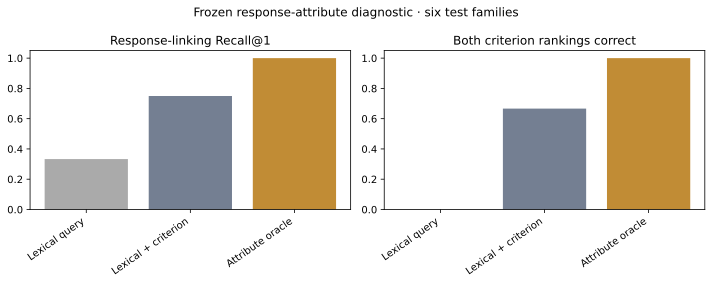

# Follow-up execution results

This is an author-designed attribute diagnostic, not a validated JEP benchmark. Identical incident passages and seven response candidates are ranked under two criteria: completed named-party response versus acknowledged voice. All response candidates contain positive/supportive language; proposed, unknown-completion, other-beneficiary, sanction and non-repetition controls remain distinct.

| Method | Test Recall@1 | Both criterion rankings correct | Passive top-set stability |
|---|---:|---:|---:|
| lexical_query | 0.333 | 0.000 | 1.000 |
| lexical_with_condition | 0.750 | 0.667 | 0.833 |
| attribute_oracle | 1.000 | 1.000 | 1.000 |

The attribute oracle consumes authored structured fields and is only an upper bound. The neutral retriever receives the same passage/pool for both criteria, so its inability to reverse rankings is expected by construction; criterion-aware lexical retrieval is the more informative control. Invariance alone can be achieved by a useless constant ranker. No supervised parameters were fitted or chosen on these test families.

Results need Spanish testimony, independently judged relevance, and measured reviewer effort before any claim of JEP utility. This test links an actual response to a named party/incident; retrieving analogous repairs for other victims is a different relation and should not inherit these negative labels.
