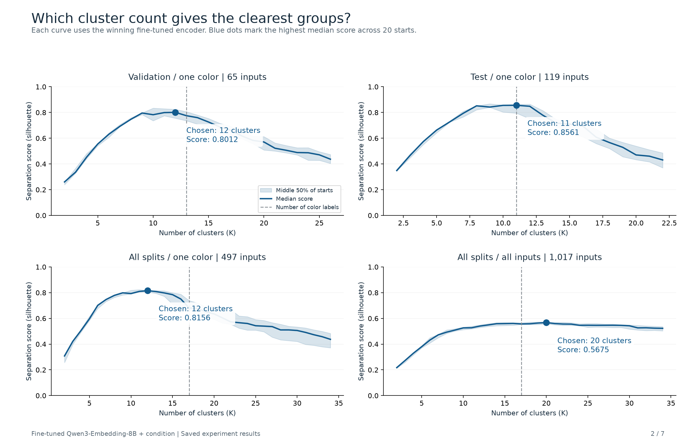

# C-STS conditional color clustering

Review artifacts are published in this GitHub directory.

- [Key charts, winning configuration and cluster-count scores](key_charts/)
- [Seven-page key-chart PDF](key_charts/csts-color-key-charts.pdf)
- [PNG/SVG charts and tables ZIP](key_charts/csts-color-key-charts.zip)
- [All 86 diagnostic pages](csts-color-clustering-diagnostics.pdf)
- [Measured results and interpretation](report.md)
- [Numeric summary and native run references](summary.json)

