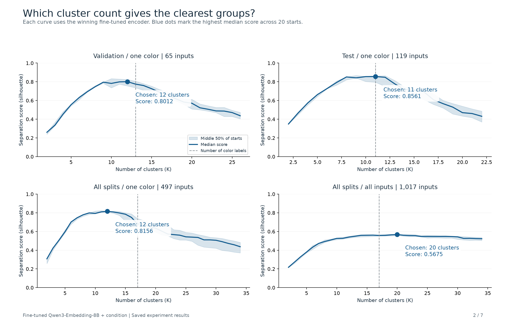
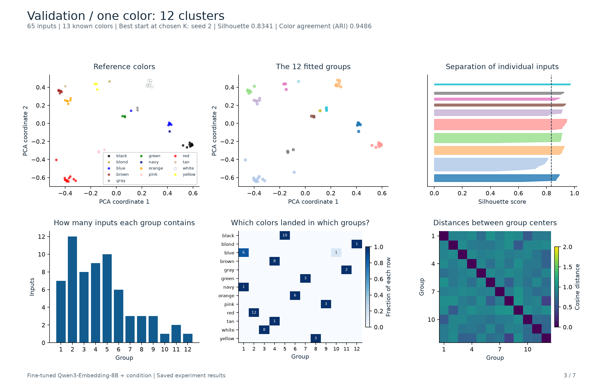
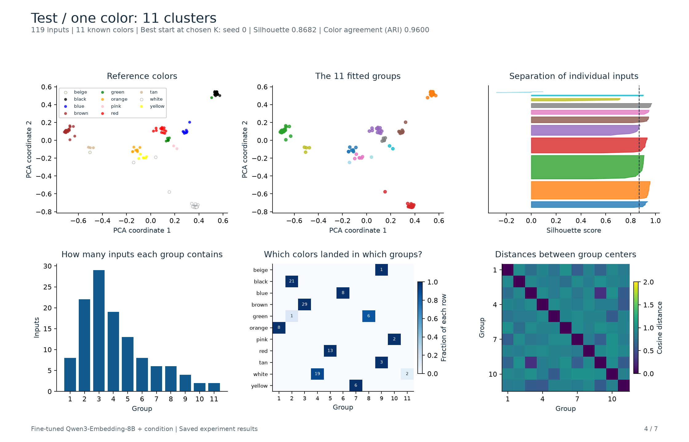
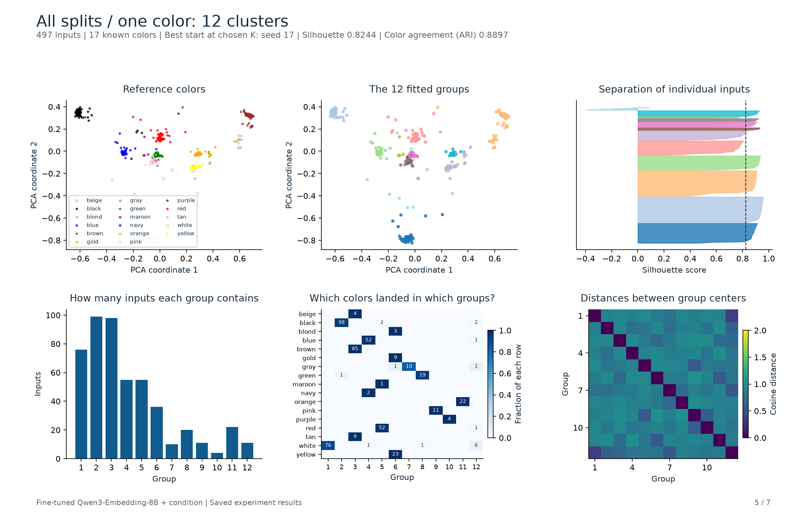
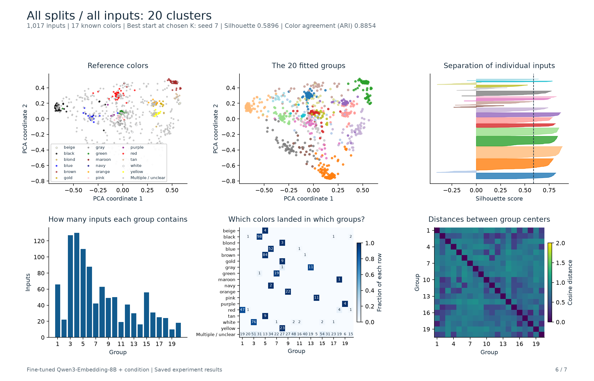
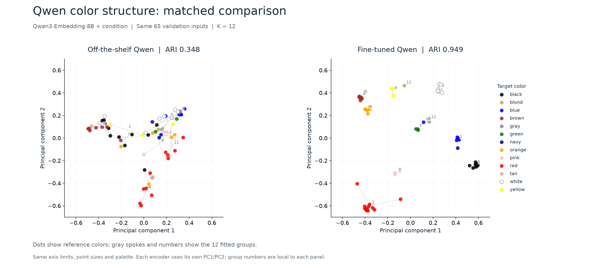
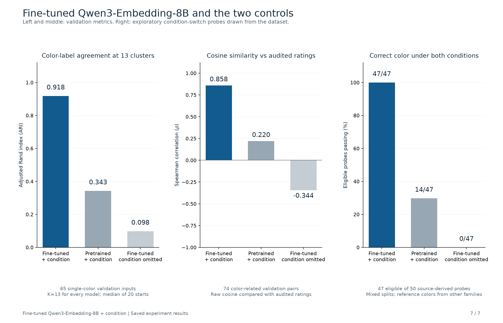

# Fine-tuned Qwen: key charts

[View the 7-page PDF](csts-color-key-charts.pdf) · [Download charts and tables](csts-color-key-charts.zip)

Winning encoder: **fine-tuned Qwen3-Embedding-8B with the original color condition included**. Each point is one sentence plus its condition. Existing vectors and cluster assignments are reused.

| Input group | Inputs | Known color labels | Chosen clusters | Median silhouette |
|---|---:|---:|---:|---:|
| Validation, one clear target color | 65 | 13 | 12 | 0.8012 |
| Test, one clear target color | 119 | 11 | 11 | 0.8561 |
| All splits, one clear target color | 497 | 17 | 12 | 0.8156 |
| All splits, all selected inputs | 1,017 | 17 among clearly labeled inputs | 20 | 0.5675 |

The chosen cluster count has the highest median silhouette across 20 random starts. Higher scores mean inputs are closer to their own group than to the nearest other group. The PDF and [winner table](k-winners.csv) also show the highest individual run across all counts and starts. Cluster plots use the highest-scoring start at the chosen count.

## Cluster-count comparison

## Validation: 12 groups

## Test: 11 groups

## All single-color inputs: 12 groups

## All selected inputs: 20 groups

## Matched comparison at K = 12

Both panels use K = 12 and the same 65 validation inputs, target-color palette, point sizes and axis limits. Gray spokes connect each sentence to its assigned group's mean PCA position. Each encoder uses its own PC1/PC2 projection; cluster numbers identify groups within each panel.

[Comparison, standalone charts and plotted data](matched-k/). The plotted-fit ARIs are 0.3478 off-the-shelf and 0.9486 fine-tuned. Across 20 starts at K=12, median ARIs are 0.3475 and 0.9375. The ARI bars below use K=13, the number of reference colors.

## Comparison with the controls

The three panels use different metrics:

- **Left: adjusted Rand index (ARI).** Cluster assignments versus the reference color labels for 65 single-color validation inputs, using K=13 for all three encoders. Bars show medians over 20 starts.
- **Middle: Spearman correlation.** Raw embedding cosine similarity versus audited ratings for 74 validation pairs.
- **Right: condition-switch probe counts.** Of 50 source-derived probes, 47 have enough reference examples to score. A probe passes when both condition-specific vectors prefer their intended color reference. References exclude the probe's caption family. These exploratory probes draw from multiple dataset splits.

## Files and interpretation

- [Cluster-count winners](k-winners.csv): both selection policies for every cohort.
- [Silhouette scores by cluster count](silhouette-by-k.csv): medians, quartiles and best scores.
- [Plotted fits](selected-runs.csv): cluster count, initialization seed and scores.
- [Plotted inputs](selected-point-data.csv): sentence, condition, reference color, group, silhouette and PCA coordinates.
- [Encoder configuration](winning-model.json): checkpoint identity and archived settings.
- [PNG and SVG figures](figures/).

All-inputs results include multiple-color, unspecified and unresolved cases. Single-color results require one clearly resolved relevant color. Reference labels are provisional and were frozen before inference. Group numbers in this pack start at 1.

The two-dimensional positions reuse the original PCA coordinates. Clustering and numerical scores use the original normalized 4,096-dimensional vectors. Per-point silhouettes were recomputed from those vectors and checked against each saved fit score within 1e-5. No encoder training, encoding or k-means fitting is repeated for this pack.

[Full measured report](../report.md) · [All 86 diagnostic pages](../csts-color-clustering-diagnostics.pdf)
