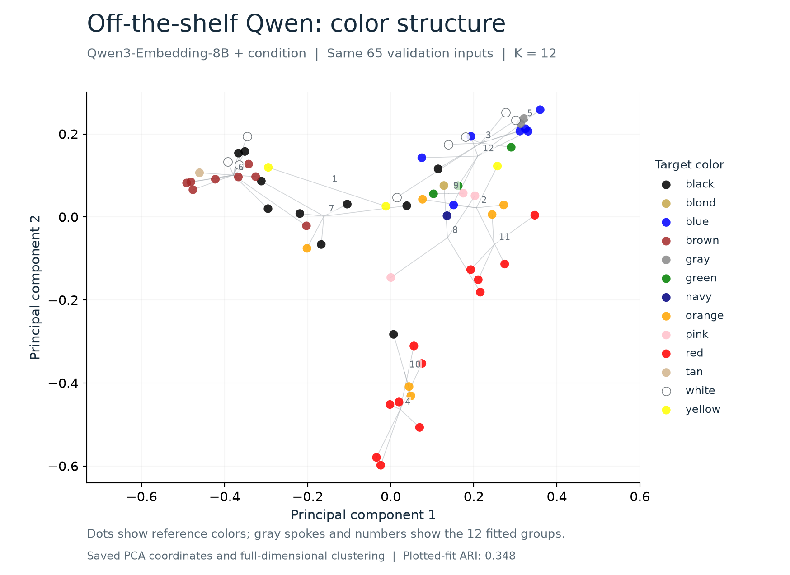

# Off-the-shelf Qwen at K = 12



K = 12 matches the [fine-tuned validation plot](../figures/02-validation-single-12-clusters.png), selected by the highest median silhouette over 20 starts. Both figures use the same 65 single-color validation inputs and target-color palette.

Dots show reference target colors. Gray spokes connect each group's members to their mean PCA position; numbers identify the 12 fitted groups. The off-the-shelf Qwen3-Embedding-8B encoder receives the original condition. The illustration reuses its original PCA coordinates and saved K=12 assignments, choosing the highest-silhouette start (seed 18) under the fine-tuned chart's plotting policy.

Clustering uses normalized 4,096-dimensional embeddings. PCA is fitted separately for each encoder. Across 20 starts at K=12, median ARI is 0.3475 off-the-shelf and 0.9375 fine-tuned. The illustrated off-the-shelf fit has ARI 0.3478. Reference labels are provisional; see the [measured report](../../report.md).

[SVG](off-the-shelf-qwen-k12-pca.svg) · [Point coordinates and groups](off-the-shelf-qwen-k12-points.csv) · [Fit metadata](off-the-shelf-qwen-k12-metadata.json)

Reproduce from the original native review archive:

```sh
python3 build_pretrained_pca.py /path/to/native-review.zip --out .
```

The generator requires Python, NumPy and Matplotlib. It checks all 65 point IDs, 13 reference colors, 12 occupied clusters, normalized vectors, finite coordinates and the saved cosine silhouette. The metadata records the archive SHA-256.
