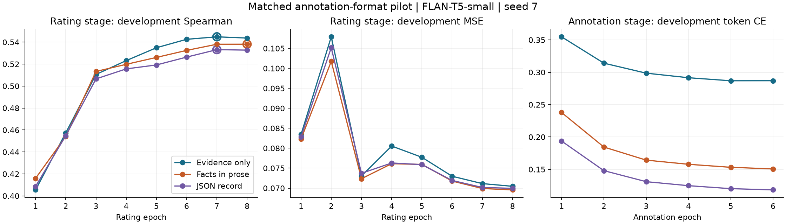

# Cached annotation-format pilot

All six training stages and three evaluations completed. All three checkpoints were frozen before the shared benchmark was evaluated. Native metrics were verified independently, and the small artifacts were restored through sealed VIPER references with SHA-256 checks.

## Comparison

Each arm starts from the same FLAN-T5-small revision and seed 7. It receives six annotation epochs followed by eight rating epochs, a fresh rating optimizer, batch size 32, per-answer token cross-entropy and rating MSE. Annotation checkpoints are selected by development cross-entropy; rating checkpoints by development Spearman. Every arm completes the full update budget.

A contains cached evidence alone. B adds the cached target and attribute in deterministic prose. C expresses those same three facts as JSON. A to B tests extra metadata and its prose presentation. B to C tests serialization while holding facts constant; token lengths still differ. All three formats reuse the existing teacher cache and its semantic fields.

| Annotation target | Benchmark Spearman | MSE, 0–1 | Condition ordering | Dev Spearman | Selected epochs, A/R |
|---|---:|---:|---:|---:|---:|
| Evidence only | 0.486629 | 0.133742 | 78.74% | 0.544867 | 5/7 |
| Facts in prose | 0.486475 | 0.131932 | 78.07% | 0.538134 | 6/8 |
| JSON record | 0.483989 | 0.132524 | 77.97% | 0.533175 | 6/7 |

The benchmark contains 2,620 comparisons in 1,241 connected source-caption components. Condition ordering uses 1,044 eligible within-pair comparisons and half credit for tied predictions.

## Paired uncertainty

Paired source-component bootstrap: 2,000 draws, seed 61021, percentile 95% intervals. Each draw reuses the same sampled components for every arm. Each row subtracts the arm named after “minus” from the arm named before it. Positive Spearman differences and negative MSE differences favor the arm named before “minus”. These intervals capture evaluation-sample uncertainty conditional on the trained models.

| Difference | Spearman delta [95% interval] | MSE delta [95% interval] |
|---|---:|---:|
| Facts in prose minus Evidence only | -0.000154 [-0.011181, +0.009874] | -0.001810 [-0.003629, +0.000088] |
| JSON record minus Evidence only | -0.002640 [-0.012992, +0.007265] | -0.001218 [-0.003020, +0.000674] |
| JSON record minus Facts in prose | -0.002486 [-0.006903, +0.001946] | +0.000592 [-0.000239, +0.001478] |

The paired Spearman interval includes zero, leaving the JSON-versus-prose difference unresolved in this one-seed screen.

## Training cost and convergence

The six training stages took 24.23 minutes in total on one NVIDIA L4. This sums the recorded fit timers, including within-fit development passes; native publication, restore, verification, provisioning and final reporting add elapsed time. Profiling estimated 21.00 minutes before that overhead. Cost reporting is limited to recorded compute time.

| Target | Annotation min | Rating min | Nonpadding annotation target tokens | Updates, A/R | Peak CUDA GiB |
|---|---:|---:|---:|---:|---:|
| Evidence only | 4.23 | 2.43 | 441,786 | 1314/1752 | 5.67 |
| Facts in prose | 5.94 | 2.63 | 1,582,254 | 1314/1752 | 8.03 |
| JSON record | 6.32 | 2.68 | 2,074,986 | 1314/1752 | 8.89 |

The circles identify rating checkpoints selected by development Spearman. Traces preserve every epoch, including later MSE improvements. Cross-entropy values across target formats have different token composition and boilerplate; they should be read as within-format convergence diagnostics.

## Common generation diagnostic

The same 32 accepted development passage-condition examples were generated greedily after rating training. Evidence is extracted from each format before token comparison. A malformed prose or JSON output receives zero evidence agreement. These automatic comparisons measure agreement with cached teacher answers; expert factuality remains unmeasured.

| Target | Valid output format | Whole-target exact | Evidence exact, normalized | Evidence token F1 |
|---|---:|---:|---:|---:|
| Evidence only | 100.0% | 62.5% | 62.5% | 0.7986 |
| Facts in prose | 100.0% | 34.4% | 56.2% | 0.7785 |
| JSON record | 0.0% | 0.0% | 0.0% | 0.0000 |

All 32 JSON outputs fail the strict JSON parser. Adding only the outer braces makes 32 of 32 outputs parse with the required string fields. The reported zero evidence agreement therefore reflects the strict format gate. The generated strings still contain an evidence field whose content requires separate assessment. This post hoc inspection leaves all benchmark scores and the recorded diagnostic unchanged.

All 96 raw outputs, parsed records and item scores are saved in [the generation file](csts_annotation_format_generations.json).

## Provenance and scope

Inputs come from LivNLP/C-STS-Reannotated revision 058ac842f5f19d27b08ad54f6d4a2c50b3f9578b. Its released validation ratings match all 2,834 of Tu et al.'s human reannotations; excluding 214 invalid rows leaves 2,620 evaluation comparisons. LivNLP's separate training ratings use human/LLM aggregation. [Row-level label audit](csts_sol61_max_label_audit.json).

The teacher cache has 17,334 records and 11,312 accepted evidence answers. All formats preserve identities, order, coverage and masked missing answers. The original source-span and teacher-review acceptance checks are retained. A stratified assistant review flagged nine of 100 records: four for condition ambiguity, two for partial information and three for inference. The remaining 91 records passed that review. The assistant review provides a diagnostic; expert annotation accuracy remains unmeasured.

Training-seed variation remains unmeasured with one seed. The already-examined benchmark is a follow-up screen. The pilot retains its prospectively frozen architecture, formats, hyperparameters and checkpoint-selection rule. A confirmatory test requires a prospectively specified comparison and independently reviewed Spanish JEP evidence.

Training source: `47864845b6520ae49676c27d0224513ac161388a`. Model revision: `0fc9ddf78a1e988dac52e2dac162b0ede4fd74ab`. Native VIPER: `e4ce91fa0a9330e769644aba0fccdfe062d5d821`. Driver 580.126.20, Python 3.13.15, PyTorch 2.14.0+cu130. The frozen selection, full traces, predictions, exact native references and restored-file checksums are linked below.

- [Aggregate results and paired intervals](csts_annotation_format_results.json)
- [Native verification and sealed artifact addresses](csts_annotation_format_native_verification.json)
- [Frozen selection](csts_annotation_format_evidence/selection.json)
- [Full evidence folder](csts_annotation_format_evidence)
- [Original protocol](csts_annotation_format_protocol.md)

Checkpoints and resume states remain in their native sealed storage and on the pilot disk. The review bundle restores the smaller traces, predictions, generations and record documents. Retrieval uses each artifact's exact stored_at reference and sha256.

Shutdown status is recorded separately in csts_annotation_format_shutdown.json after durable report publication.
