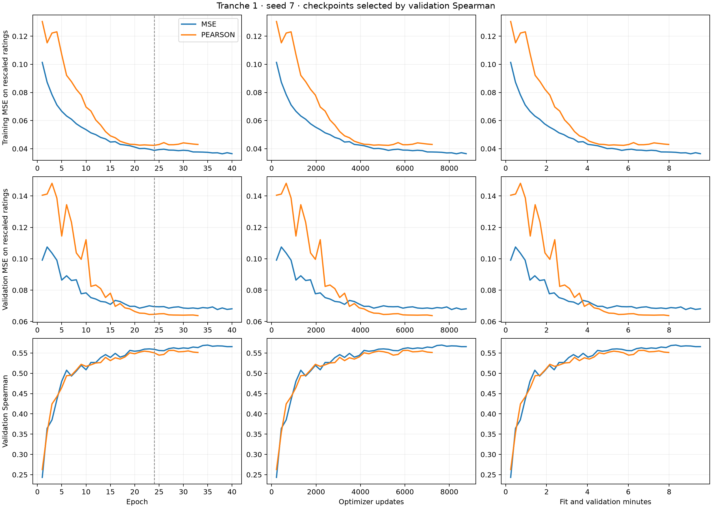

# Rating-training continuation

Source: `ffa81e7bbd6d26d152aadf966a787ce17293b9d0`. Resume the completed seed-7 MSE and Pearson runs after epoch 24. Encoder LR is 3e-6 and projection LR is 1e-4, held constant through this phase. Validation Spearman selects checkpoints and drives patience five, with a ceiling of 48 total epochs.

| Arm and phase | Selected epoch | Test Spearman | Raw MSE | Calibrated MSE |
| --- | ---: | ---: | ---: | ---: |
| MSE, original | 23 | 0.496895 | 0.134145 | 0.130830 |
| MSE, continued | 35 | 0.506417 | 0.132350 | 0.129473 |
| Pearson, original | 22 | 0.484205 | 0.131099 | 0.131126 |
| Pearson, continued | 28 | 0.487140 | 0.130195 | 0.130528 |

MSE uses targets rescaled through $y=(r-1)/4$ and raw cosine predictions. MSE on the original 1–5 rating scale is 16 times the reported value.

This continuation asks whether the 24-epoch rating baseline still benefits from additional optimization. It introduces an explicit constant-rate restart, so its gains describe that continuation policy. Validation selects the ranking baseline; actual update counts differ between the arms under the same patience rule.

The test ratings are Tu's 2024 human reannotations distributed by LivNLP; 214 invalid comparisons were excluded. Training and validation use the release's separate human/LLM aggregation. See the [label audit](csts_sol61_max_label_audit.json).

The original epoch-23 MSE and epoch-22 Pearson winners remain incumbents throughout the continuation. AdamW moments, terminal weights and RNG state were restored from epoch 24. Both continued checkpoints and validation calibration were frozen before test access. Unchanged checkpoint bytes reuse their original completed evaluation.

## Paired uncertainty

- MSE, continued minus original: Spearman difference +0.009522; paired 95% interval [+0.006371, +0.012440].
- Pearson, continued minus original: Spearman difference +0.002935; paired 95% interval [-0.000159, +0.006066].
- Continued Pearson minus continued MSE: Spearman difference -0.019277; paired 95% interval [-0.027001, -0.011513].

The 2,000 paired bootstrap draws resample the same 1,241 source components across candidates. Intervals are conditional on this training seed. This follow-up uses an already examined benchmark; confirmation requires a prospectively chosen comparison and independently reviewed Spanish JEP data.

## Training and stopping

- MSE: stopped at epoch 40 after 16 additional epochs and 3,504 updates; reason `validation_patience`. Fitting took 3.57 minutes and validation 0.28 minutes. Final training objective: 0.036476.
- PEARSON: stopped at epoch 33 after 9 additional epochs and 1,971 updates; reason `validation_patience`. Fitting took 2.05 minutes and validation 0.16 minutes. Final training objective: 0.224491.

Patience reports a validation plateau under the declared rule. Batch gradient norms are recorded before clipping as an optimization diagnostic; they use stochastic batches and changing weights. A stationary training minimum remains unproven.

Training and evaluation use native VIPER stages. Local verification precedes downstream computation; cloud promotion runs in an independent CPU worker. Native cloud publication and shutdown receipts are separate closeout artifacts. The previous studies, completed reports and original stopped VM remain preserved.

## Evidence and timing

All five experiment graphs and 79 native measurements passed verification. The 68-file evidence archive passed transfer and SHA-256 manifest checks. [Native references](csts_continuation_native_verification.json), [collection receipt](csts_continuation_collection.json) and the [evidence archive](csts_continuation_evidence.tar.gz) preserve the exact cloud references for model and optimizer artifacts.

The two prediction loops totaled 4.38 seconds. Their foreground native evaluation invocations totaled 133.87 seconds. Independent metric-verification worker bodies totaled 15.76 seconds; interpreter startup and whole-graph verification remain outside that figure. See the [timing breakdown](csts_continuation_timing.json).

Cloud promotion ran alongside later computation and report analysis. Each publication performed the native graph checks; those checks were retained. Moving the uploader to another host remains a separate infrastructure change.
