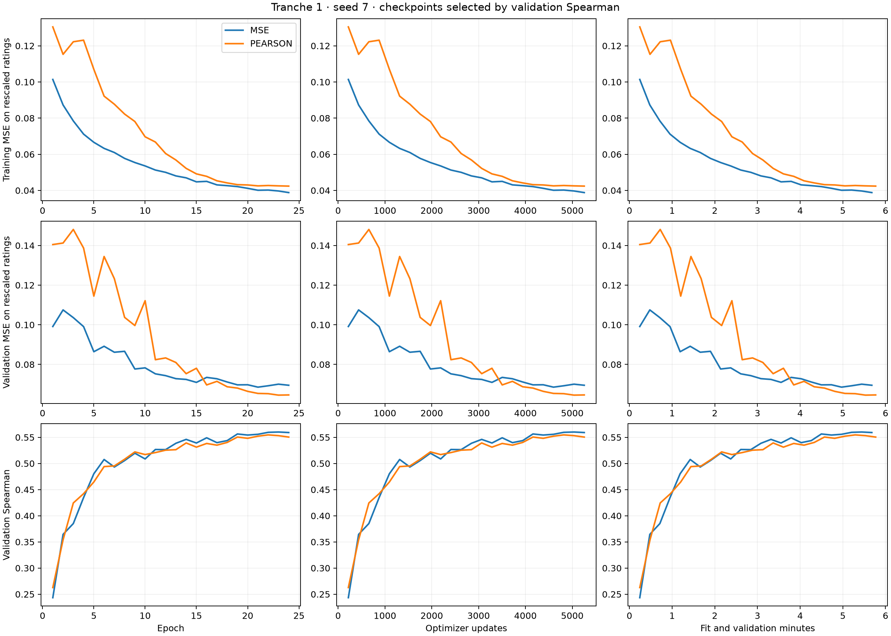

# Tranche 1: loss and convergence

Source: `e2545bbc8e509d12b01e12ce43435b897bcb410f`. One matched seed (7), 24 epochs per arm.

Evaluation source: `182cfc35e5ab528e1239668b881c1779ffba0437`. Frozen training, checkpoint choices and validation calibration retain their original identities.

The hypotheses are that continued rating training improves conditional ranking, and that Pearson can improve ranking over MSE under shared settings. This screen supplies a stronger rating-only reference for later evidence-supervision experiments. See the [experiment plan](../plans/csts-tranche-1.md).

Both arms used the same initialization, batch order, model and optimizer settings, with BF16 forward computation and float32 loss arithmetic. Checkpoints were selected by highest validation Spearman within each window. Test scoring used native VIPER EVAL stages with independent metric workers. Training and checkpoint selection finished before testing.

Test ratings are the Tu 2024 human reannotations distributed by LivNLP; the fixed cohort excludes 214 invalid comparisons. Training labels separately use human/LLM aggregation. Label provenance is documented in the [existing audit](csts_sol61_max_label_audit.json).

The provisional loss selected using validation Spearman is **MSE**.

MSE uses targets $y=(r-1)/4$ and raw cosine predictions: $n^{-1}\sum_i(s_i-y_i)^2$. MSE on the original 1–5 rating scale equals 16 times this value.

| Candidate | Selected epoch | Test Spearman | Raw MSE | Calibrated MSE | Condition ordering |
| --- | ---: | ---: | ---: | ---: | ---: |
| mse_prefix | 6 | 0.428138 | 0.152741 | 0.140377 | 75.77% |
| mse_full | 23 | 0.496895 | 0.134145 | 0.130830 | 80.08% |
| pearson_prefix | 8 | 0.446105 | 0.163555 | 0.137821 | 77.68% |
| pearson_full | 22 | 0.484205 | 0.131099 | 0.131126 | 79.31% |

Condition ordering compares the same passage pair under different conditions with distinct human ratings, assigning half credit to tied predictions. Counts and score distributions are retained in the result JSON.

Paired differences below use 2,000 shared bootstrap samples of connected test-caption groups; intervals are conditional on seed 7.

- pearson_full_minus_mse_full: Spearman difference -0.012690, 95% interval [-0.019612, -0.005784]; MSE difference -0.003047, 95% interval [-0.004696, -0.001394].
- mse_full_minus_prefix: Spearman difference +0.068757, 95% interval [+0.051916, +0.085153]; MSE difference -0.018596, 95% interval [-0.022063, -0.015015].
- pearson_full_minus_prefix: Spearman difference +0.038100, 95% interval [+0.023702, +0.054129]; MSE difference -0.032456, 95% interval [-0.037184, -0.027653].

The primary paired test interval favors MSE for ranking on this test cohort.

This compares the objectives under one shared optimizer setting. Each objective's best achievable performance remains open.

The predeclared practical target for expanding a change into repeated-seed confirmation is 0.02 Spearman. The two within-objective duration contrasts are exploratory.

- **MSE**: The strongest validation checkpoint occurred near the epoch limit. The longer budget improved validation ranking; convergence beyond this budget remains unresolved. Fitting took 5.26 minutes and validation 0.42 minutes, with 5,256 updates and 9,456,864 nonpadding input tokens.
- **PEARSON**: The strongest validation checkpoint occurred near the epoch limit. The longer budget improved validation ranking; convergence beyond this budget remains unresolved. Fitting took 5.35 minutes and validation 0.42 minutes, with 5,256 updates and 9,456,864 nonpadding input tokens.

The eight-epoch prefix uses the same 24-epoch schedule as the full run. Its contrast measures continued training under that schedule. Each objective has its own loss units; the curves show common MSE and Spearman metrics, while the epoch CSV preserves the actual training objectives.

Positive affine calibration was fitted using validation data, with five caption-group folds for its held-out error estimate. Raw cosine supplies the primary ranking result. Calibration coefficients were frozen before testing.

Native GPU-stage wall time, including publication and failed scoring attempts: 27.97 minutes against the original 30-minute ceiling. Successful runs and exact sealed checkpoint references are preserved in the result JSON and native verification receipts.

The first prefix evaluation failed VIPER's stored-model artifact-name check after inference. The failed graph and metric receipts were preserved. A CPU BUILD stage copied each prefix checkpoint byte for byte to canonical `model`, with matching SHA-256 checks. Recovery executed scoring from the original frozen checkpoints; both training arms and the selection document were retained.

This is a follow-up screen on an already examined test set. One seed limits claims about training variation. Confirmation requires prospectively chosen comparisons, repeated seeds, fresh source groups and independent Spanish JEP review.

The four successful prediction loops took **8.62 seconds total**. Their complete native evaluation envelopes took **7.30 minutes**, including startup, input handling, publication and verification. The initial failed evaluation added 2.23 minutes; CPU handoffs, repair and separate collection add wall time outside these GPU-stage counters. This overhead is excessive for the inference workload. Exact counters and per-checkpoint loop times are in [evaluation timing](csts_tranche1_evaluation_timing.json).

The independent CPU metrics match VIPER's saved metric events within 1e-12. The transferred archive and every manifest file passed size and SHA-256 checks. [Native verification](csts_tranche1_native_verification.json) · [Evidence archive](csts_tranche1_evidence.tar.gz) · [Collection receipt](csts_tranche1_collection.json).

The provisional choice remains MSE. Its test ranking advantage is smaller than the predeclared 0.02 practical target; continued training provides the larger observed gain. Pearson has lower raw MSE, while validation-fitted calibration brings the numerical errors close together. These conclusions apply to this seed and the existing benchmark.
