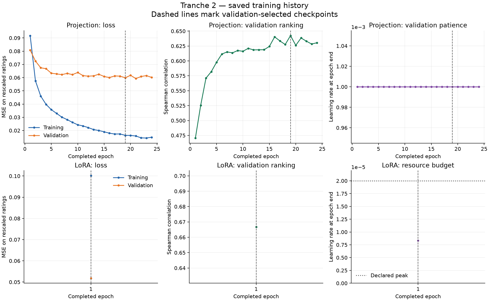

# Tranche 2: encoder baseline hierarchy

The LoRA checkpoint, selected using validation, scored 0.702170 test Spearman after one completed epoch. The frozen projection scored 0.620045, and the saved trained FLAN baseline scored 0.506417. LoRA minus projection is +0.082125, with a paired 95% bootstrap interval [+0.060204, +0.102204].

The validation-chosen frozen projection improved over FLAN by +0.113628, with a paired 95% interval [+0.086168, +0.142099].

Fitted checkpoints and ridge penalties were selected using validation before test scoring. The mean and frozen cosine retain their predeclared settings. Native verification and collection manifests were checked before this independent analysis.

| System | Test Spearman | MSE on rescaled ratings |
| --- | ---: | ---: |
| Frozen Qwen cosine | 0.297897 | 0.188437 |
| Qwen + ridge | 0.583119 | 0.113816 |
| Qwen + projection | 0.620045 | 0.106738 |
| Qwen + LoRA | 0.702170 | 0.098487 |
| Trained FLAN (saved) | 0.506417 | 0.132350 |
| GPT joint judgment (saved) | 0.802917 | 0.064261 |
| Training mean | undefined (constant) | 0.168107 |

Targets are rescaled through `(rating - 1) / 4`. Raw cosine and ridge scores remain unclipped. The GPT reference judges both passages jointly; the embedding systems encode each passage independently under its condition.

## Training and stopping

Qwen + projection: completed epoch 24, selected epoch 19; stop reason `validation_patience`. This phase used 38.38 fitting seconds and 4.51 validation seconds.

Qwen + LoRA: completed epoch 1, selected epoch 1; stop reason `resource_budget`. This phase used 1850.78 fitting seconds and 97.65 validation seconds.

## Paired uncertainty

- Qwen + projection minus Frozen Qwen cosine: +0.322148; paired 95% interval [+0.290097, +0.354106].
- Qwen + projection minus Trained FLAN (saved): +0.113628; paired 95% interval [+0.086168, +0.142099].
- Qwen + ridge minus Frozen Qwen cosine: +0.285222; paired 95% interval [+0.253689, +0.318227].
- Qwen + ridge minus Trained FLAN (saved): +0.076702; paired 95% interval [+0.050285, +0.103970].
- Qwen + LoRA minus Frozen Qwen cosine: +0.404273; paired 95% interval [+0.376782, +0.430913].
- Qwen + LoRA minus Trained FLAN (saved): +0.195753; paired 95% interval [+0.163980, +0.227520].
- Qwen + LoRA minus Qwen + projection: +0.082125; paired 95% interval [+0.060204, +0.102204].

The 2,000 paired draws resample the same source components across candidates. Intervals describe test-sample uncertainty conditional on seed 7. Final confirmation requires prospective comparisons and independently reviewed Spanish JEP groups.

Native GPU-stage wall times include the local native invocation. Promotion timing remains a separate CPU worker interval and includes upload plus native cloud verification. Persistent model and optimizer bytes remain available through the sealed references in each phase's native verification file.

Validation patience supplies an empirical stopping observation. A stationary training minimum remains unresolved.

## Curves and observed cost

| Phase | Time in GPU stages (minutes) | New neural fit seconds |
| --- | ---: | ---: |
| frozen | 12.43 | 38.38 |
| lora | 38.35 | 1850.78 |

The frozen phase shares its training/validation cache and subsequent test cache across all four scorers. Projection fitting runs on CPU. Time in GPU stages includes model loading, execution and local native overhead. Fit seconds cover optimizer work within completed epochs; validation time remains separate in the results JSON. Training MSE averages losses encountered during an epoch as the weights change; validation uses the weights at its end. VM startup, preflights and publication extend the allocated VM lifetime beyond these stage times; the shutdown receipt records its start and stop timestamps.

## Conditional ordering

For a fixed passage pair, this diagnostic asks whether a system ranks the higher-rated condition above the lower-rated condition. Tied scores receive half credit. The 1,044 comparisons reuse passages and remain dependent.

| System | Conditional ordering accuracy |
| --- | ---: |
| Frozen Qwen cosine | 66.38% |
| Qwen + ridge | 84.67% |
| Qwen + projection | 86.78% |
| Qwen + LoRA | 87.74% |
| Trained FLAN (saved) | 80.08% |
| GPT joint judgment (saved) | 92.24% |
| Training mean | 50.00% |

## Interpretation and limits

The supervised frozen head improves substantially over raw cosine in this one-seed screen. Frozen Qwen cosine gives a lower conditional ranking score than the trained FLAN reference. These observations support testing the representation together with its scoring head.

The systems have different pretraining and fitting histories. Projection learns a 128-dimensional head over frozen vectors; LoRA adapts attention while retaining the full 4,096-dimensional cosine output. Their comparison combines the parameterization, parameter count and training schedule. A controlled adaptation ablation would hold the scoring head and schedule fixed.

Ridge selected alpha 1, the largest value in its predeclared grid. The grid boundary limits conclusions about ridge's best attainable performance.

LoRA completed 1 epoch and 219 updates, with stop reason `resource_budget`. Its declared schedule reserves 526 updates for warmup across the 24-epoch ceiling. Interpret its test result with the actual schedule progress and budget stop; a completed convergence comparison requires further training under a prospectively specified continuation.

The resource stop occurred during warmup: 219 of 526 warmup updates were completed. The final epoch-end learning rate was 8.3269962e-06, against the declared peak of 2e-05.

The bootstrap intervals quantify test-source sampling variation conditional on seed 7. Training-seed variation remains unmeasured here. The benchmark has already informed earlier work, and training/validation use the existing aggregated labels while test uses the human reannotations documented in the [label audit](csts_sol61_max_label_audit.json). Confirmation requires prospectively chosen comparisons and independently reviewed Spanish JEP groups.

## Retained evidence

The [results JSON](csts_tranche2_results.json) records scores, paired intervals, selection choices, model-run references and timing. The [cloud restoration record](csts_tranche2_cloud_restoration.json) preserves exact native references and checksum-verified small artifacts. The [file map](csts_tranche2_file_map.json) binds the published exports to the verified archive. The [execution record](csts_tranche2_execution.json) preserves settings, runtime observations and resource accounting. Best and terminal checkpoints, optimizer state and embeddings remain sealed in native storage.
