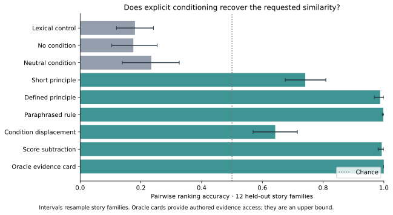
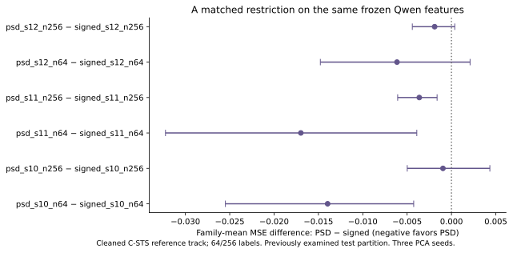
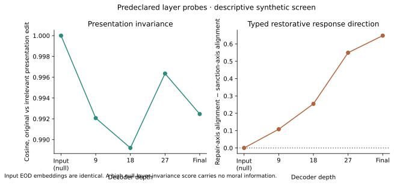
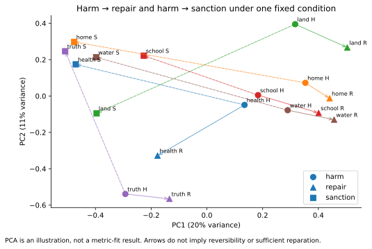

# JEP moral geometry pilot

**Recommendation: revise.**

This is a computational falsification screen using authored synthetic cases and the existing cleaned JEP C-STS dataset. It supplies no new human moral validation.

## What was actually run

- Reused the validation-selected Qwen3-Embedding-8B condition-first LoRA checkpoint; no backbone or adapter retraining.
- Compared raw, neutral, short-condition, operational-definition, paraphrase, condition-displacement, pair-score subtraction, and oracle evidence-card views on the same cross-family candidates.
- Fitted paired signed versus nonnegative diagonal kernels on frozen Qwen features, with 64/256 cleaned training labels and three randomized train-only PCA seeds. This is a narrow PSD intervention.
- Used released MET-D-Qwen3-4B weights to produce short, forced-theory views under fixed care/harm. This modifies MET inference; it does not reproduce its ground selector or self-distillation training.
- Collected predeclared layer 0/9/18/27/final EOD vectors for the theory/repair screen. Layer 0 is an identical-token null baseline.

## Conditioning and controlled retrieval

The specified interpretations are equal-person-weight expected lives saved; informed, unpressured worker consent; and equal work burdens among four equally responsible people. All cases stipulate equal linear work disutility and sixteen total work hours. These interpretations define partial expected resemblance orders, not complete ethical theories or unique numeric moral ratings.

There are twenty story families: four development, twelve primary, four reserve. A relevant candidate changes topic while preserving the requested aspect; distractors include a same-story candidate changing that aspect. Synthetic families are never used to train Qwen or the geometry heads. Candidate position ties receive expected random-tie credit.

The development-selected method was **paraphrase**. Its identity was recorded before reserve metrics. Oracle cards were excluded from selection because they reveal authored relevant evidence spans.

| Method | Primary ranking accuracy | Family 95% interval | Reserve accuracy |
|---|---:|---|---:|
| lexical | 0.181 | [0.120, 0.241] | 0.135 |
| unconditioned | 0.175 | [0.104, 0.254] | 0.156 |
| neutral | 0.234 | [0.139, 0.326] | 0.135 |
| short | 0.741 | [0.675, 0.809] | 0.745 |
| defined | 0.988 | [0.969, 1.000] | 1.000 |
| paraphrase | 0.998 | [0.995, 1.000] | 1.000 |
| residual | 0.642 | [0.569, 0.715] | 0.615 |
| difference | 0.993 | [0.981, 1.000] | 1.000 |
| oracle_cards | 1.000 | [1.000, 1.000] | 1.000 |

Ranking accuracy compares the relevant candidate with each distractor (chance 0.5). Recall@1 and MRR use the three-candidate pool and are retained in results.json. Bootstrap units are original story families, not their correlated perturbations. With only four reserve families, confirmation remains weak.

## Does imposing geometry help?

Both kernels use the same normalized, training-only PCA features, target mapping, ridge penalty and exact convex objective. Only the restriction to nonnegative diagonal weights changes. Ordinary conditional cosine was already PSD; no distance transform is treated as an improvement. Raw kernel diagonals are preserved. No held-out labels complete or project a matrix.

| Arm | Reference Spearman | Reference MSE |
|---|---:|---:|
| restored_Qwen_cosine | 0.8327308223139328 | 0.04565 |
| signed_s10_n64 | 0.7295933232669566 | 0.07297 |
| psd_s10_n64 | 0.7585659109797092 | 0.06295 |
| signed_s10_n256 | 0.7833929773981092 | 0.05857 |
| psd_s10_n256 | 0.7874832250752036 | 0.05736 |
| signed_s11_n64 | 0.6927227497993338 | 0.08405 |
| psd_s11_n64 | 0.7444895631179965 | 0.06965 |
| signed_s11_n256 | 0.7793303665296437 | 0.06252 |
| psd_s11_n256 | 0.7855947098188876 | 0.05957 |
| signed_s12_n64 | 0.7328084053374655 | 0.07192 |
| psd_s12_n64 | 0.7417105284725233 | 0.06644 |
| signed_s12_n256 | 0.7839979164314332 | 0.05974 |
| psd_s12_n256 | 0.7844063270478399 | 0.05831 |

The reference is the existing cleaned, audited JEP C-STS labels, kept in their existing partitions. Its test examples were previously examined in other work; this is exploratory reference evidence, not a new human or untouched test benchmark. Low-label fits use the remaining training vectors without labels for PCA. Seed variation concerns the randomized basis; it is not independent evidence from new people.

## Fixed harm, different theories; reasoning and layers

The auxiliary screen holds care/harm fixed while varying explicit Utilitarianism, Deontology and Care Ethics framings. Supplied grounds and generated reasoning views remain separate from synthetic expectations. Prompt-induced separation is framing sensitivity, not evidence that a theory is correct. The short MET-D views are available for inspection in reasoning_views.json, including truncation flags.

Retained generated views: 18; generation at its token bound: 18. No view is used as a gold moral judgment.

Short decoder views that hit the token limit or contain introductory meta-discussion are not validated reasoning representations. Their geometry is a diagnostic of this failed or incomplete auxiliary arm, not evidence of a reasoning gain.

## Harm, reparation and sanction

The six authored harm-response families cover land, housing, health, education, water and truth about disappearance. We compare the direction from harm to an illustrative repair with harm to a punitive response, leaving each family out of the reference direction in turn.

This tests a typed relation. It does not assume that reparation is a reflection, inverse, or erasure of harm. Multiple remedies may be appropriate; some losses cannot be reversed. Sanctions can concern the responsible actor rather than the victim's deficit. The candidates have not been certified as sufficient reparation by JEP experts.

## Execution validity, failures and limits

Behavioral checkpoint replay on 64 cleaned validation pairs: maximum absolute cosine difference 0.009955; mean 0.002149. Exact original prediction bytes were recovered and verified before this comparison.

Five agents reviewed the code and five separately proposed methods. The rejected MiniLM/raw-dataset draft never ran as the experiment. Reviews caught wrong partition reuse, inadequate probe construction, a fake resume check, a normalization error, metadata size limits, and unsafe automatic resource deletion. Replacement boundaries and the independent metric verifier were checked separately.

Actual launch issues included an external-IP policy denial, Seoul Spot capacity failures, a missing image runtime path, an auxiliary Jinja dependency mismatch, retained model memory after an exception, and denied GPU-side return publication. These are execution failures, not negative scientific findings. The existing private network and authenticated IAP transfer preserve outputs without IAM/account changes.

No successful training or inference is repeated for plotting, reporting or upload. The hashed local outbox is authoritative while asynchronous VIPER publication is pending. Resource ownership and cleanup are retained in execution.json/cleanup.json when available.

Remaining limitations: small and structured synthetic data; partial perturbation coverage; oracle evidence access; no new expert retrieval labels; no generative-model fine-tuning; no validated moral similarity numbers; and multiple predeclared exploratory methods. A positive synthetic result motivates expert evaluation, not a moral-reasoning claim.

## Prior work and novelty boundary

- [C-STS](https://aclanthology.org/2023.emnlp-main.345/) already defines natural-language-conditioned similarity.
- [CASE](https://aclanthology.org/2026.eacl-long.231/) and [SCS](https://aclanthology.org/2026.acl-long.50/) already study conditional representation improvement and contrast. Output subtraction here is an ablation, not a reproduction of attention-level SCS.
- [Verheyen and Peterson](https://doi.org/10.1007/s13164-020-00495-5) and [Tang 2026](https://doi.org/10.1007/s43681-026-01368-w) already examine moral spaces and model–human structural alignment.
- [MET/MET-D](https://arxiv.org/abs/2607.11736) supplies theory-grounded moral reasoning and self-distillation; this pilot uses released weights with explicitly forced grounds.
- [Analogy-preserving sentence embeddings](https://aclanthology.org/K19-1085/) and [sentence analogies](https://aclanthology.org/2020.coling-main.300/) precede relation-vector probes.
- [What Comes After Harm?](https://arxiv.org/abs/2506.05687) already develops a reparative-action taxonomy. This search did not establish that conditional JEP harm-to-response translation has already been demonstrated, and does not establish novelty by absence.

The potential contribution is a controlled, theory-explicit cross-situation evaluation and useful retrieval behavior—not the existence of PSD embeddings or moral geometry.

## Outcome and follow-up decision

Defined conditioning reached 98.8% pairwise ranking accuracy, compared with 17.5% without a condition and 18.1% for the unconditioned lexical control. The development-selected paraphrase added no reserve gain over the defined-condition baseline; both reached the synthetic ceiling. This demonstrates aspect-following in these deliberately structured cases, not a new moral reasoning capability. A rule given the authored factual profiles could solve this screen perfectly.

PSD improved the small compressed heads relative to their signed counterparts, especially with 64 labels, but every head remained worse than the unchanged Qwen cosine baseline on this reference subset. This supports investigating ordinary regularization, not claiming a new moral metric advantage over the existing encoder.

The post-hoc repair-translation diagnostic retrieved the authored matched response at rank 1 in 100% of cases using ordinary cosine and 83% after a leave-one-family-out translation. It is an exploratory control, not a fresh confirmation result. Generic valence and shared topic remain alternative explanations for the apparent relation direction.

**Strict historical numerical replay did not pass.** The original runtime was PyTorch 2.14.0+cu130 / Transformers 5.20.2 / PEFT 0.21.2; this run used 2.9.1+cu129 /4.57.1 /0.17.1. Restoring the original batch layout still left a maximum absolute cosine difference of 0.016163 on the diagnostic batch. The exact adapter weights were verified, but these are new-runtime outputs, not an exact reproduction of historical predictions. All comparisons in the pilot share the current runtime.

All 18 short MET-D views hit the 96-token bound and often retained introductory meta-reasoning. The decoder-view arm therefore remains incomplete as a test of useful grounded reasoning. Preserve its outputs and improve the generation protocol on fresh scenarios before evaluating a reasoning-to-encoder gain.

The next useful study is a harder, independently reviewed cross-family dataset: implicit harms, competing principles, role-sensitive responsibility, irrelevant-fact and linguistic invariants, and valence-matched alternative remedies. Keep fixed harm under alternative explicit theories, test selective sensitivity, and compare raw text, well-formed reasoning views and matched factual extraction. All cases here are English; Spanish/Colombian cultural transfer remains untested. These changes need fresh held-outs rather than tuning this screen.
